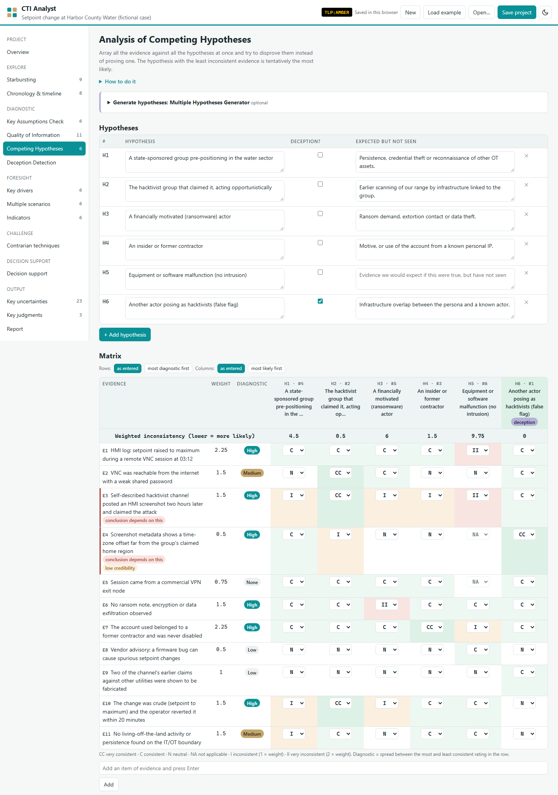
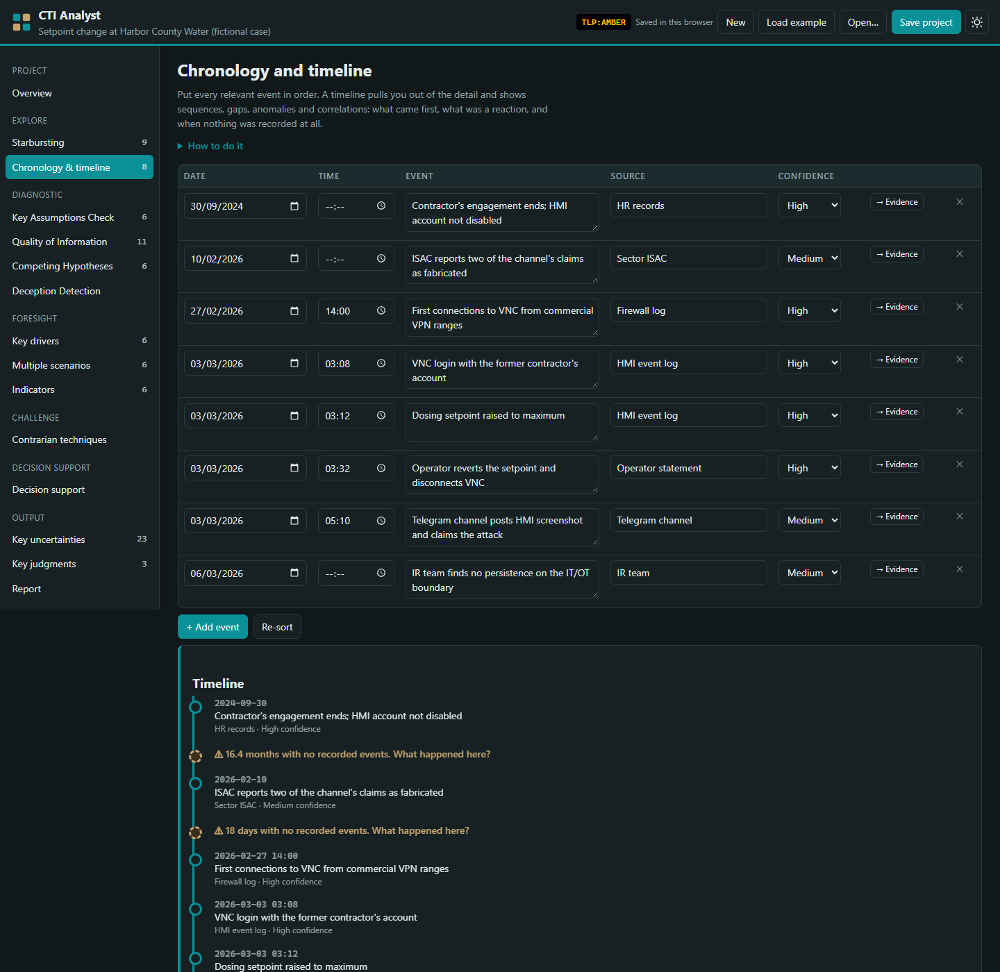
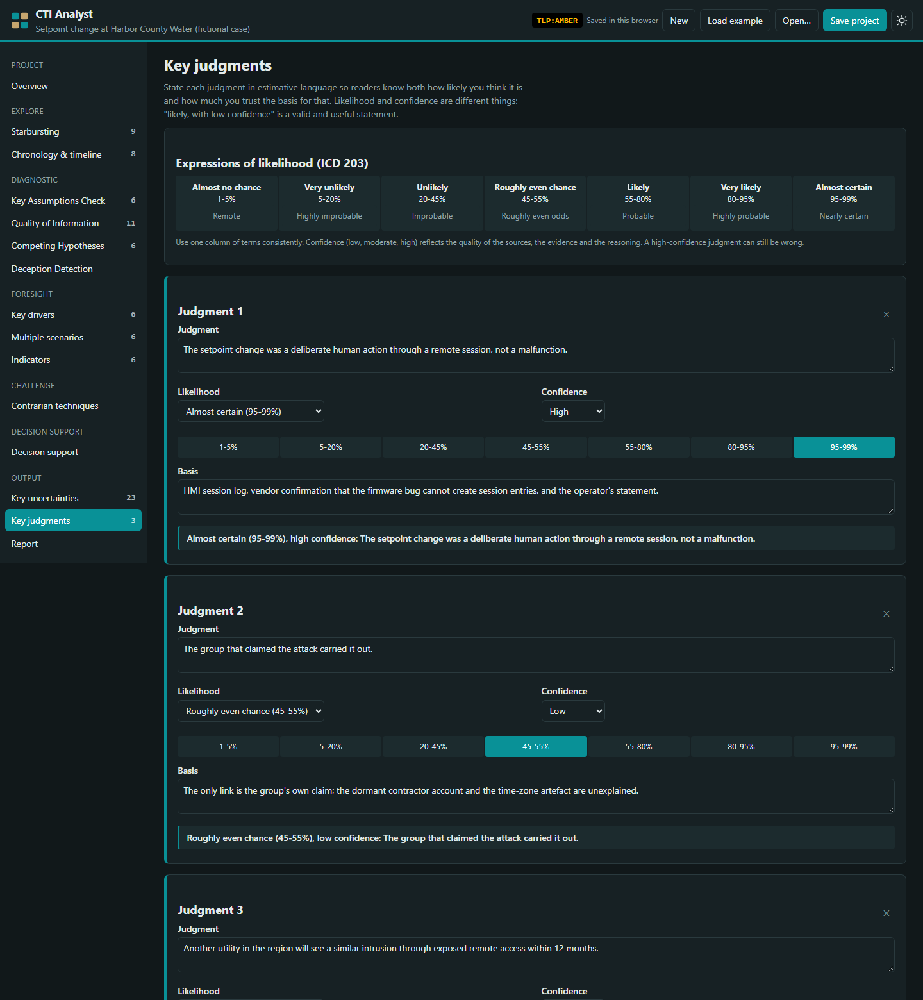
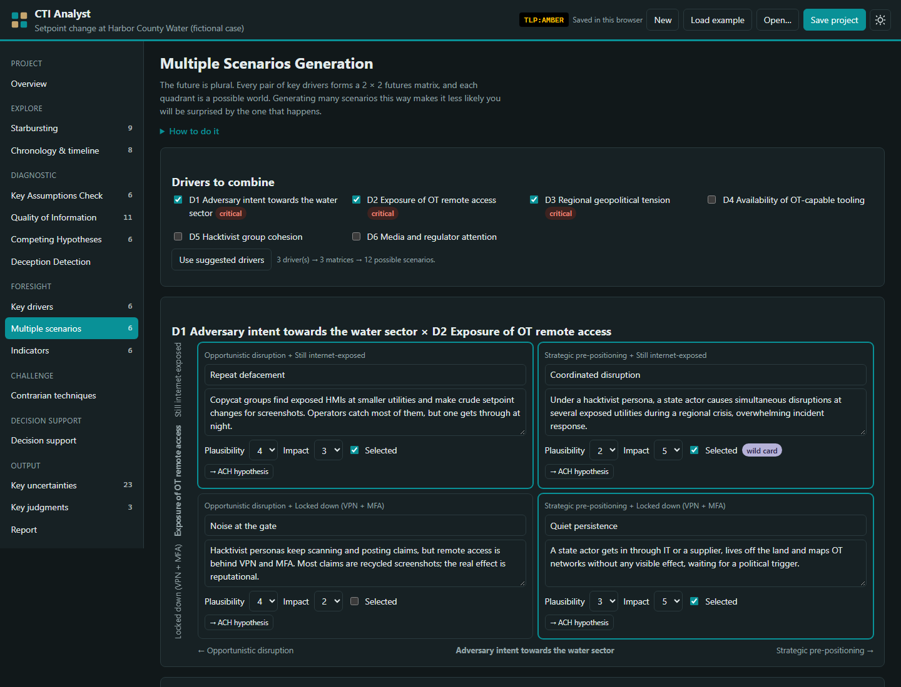
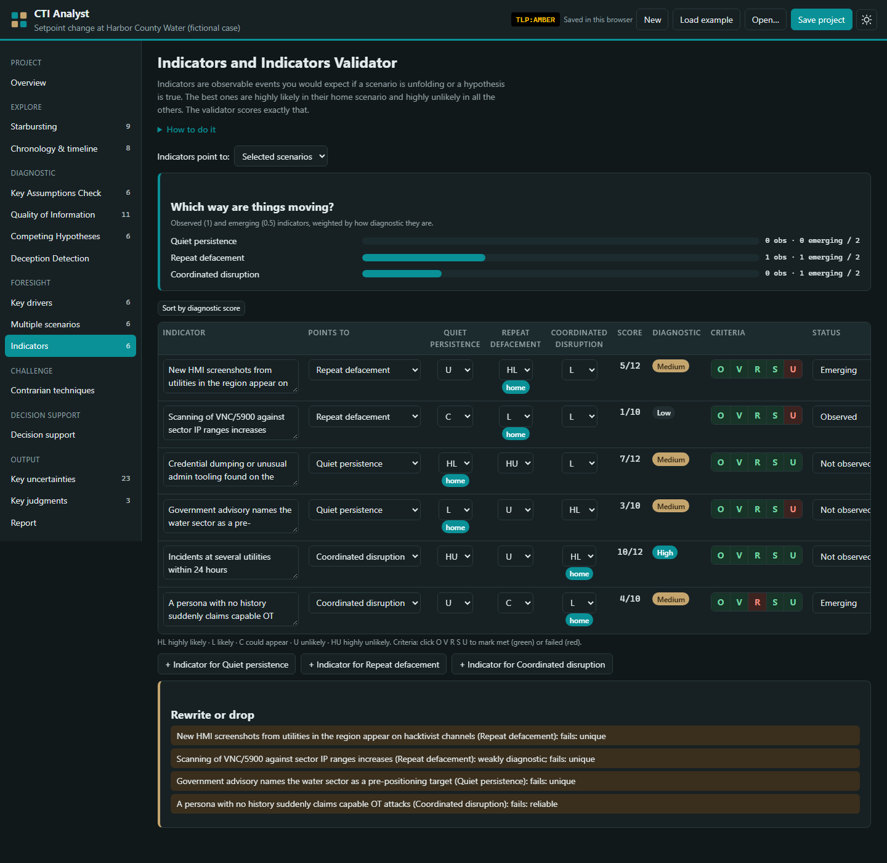

<p align="center">
  
</p>

<h1 align="center">CTI Analyst</h1>

<p align="center">
  Structured analytic techniques for cyber threat intelligence, in one offline web page.
</p>

<p align="center">
  <a href="https://c4c0nym.github.io/cti-analyst/"><strong>▶ Live demo</strong></a>
</p>

<p align="center">
  
  
  
  
</p>

Attribution and threat assessments go wrong in predictable ways. Analysts anchor on the first
explanation, read evidence that fits several hypotheses as proof of their own, and miss the
planted artefact or the actor-run "leak" that was meant to mislead them. Structured analytic
techniques make that reasoning explicit and open to challenge.

**CTI Analyst** puts the techniques from the US Government's *Tradecraft Primer* and Beebe &
Pherson's *Cases in Intelligence Analysis* into one workspace. Each technique feeds the next:
unsupported assumptions, critical drivers and evidence the conclusion depends on all end up as
key uncertainties with a collection requirement.

<p align="center">
  
</p>

## Techniques

| | Technique | What the tool does |
|---|---|---|
| **Explore** | Getting Started Checklist | What prompted the analysis, who the customer is, why it matters, what is known and when it is due |
| | Starbursting | Who / what / how / when / where / why questions around a star, each sorted by whether evidence answers it. Unanswered ones become gaps |
| | Chronology and Timeline | Ordered events with source and confidence, **automatic detection of unusually long quiet periods**, and one click to turn an event into ACH evidence |
| **Diagnostic** | Key Assumptions Check | Rate each assumption as solid, caveated or unsupported, record the impact if it's wrong, and flag wording ("always", "must", "based on") that hides an unchallenged assumption |
| | Quality of Information Check | Admiralty grading (A-F / 1-6), credibility and relevance weights, corroboration, and checks for diagnostic-but-weak evidence and single-source dependence |
| | Multiple Hypotheses Generator | Who / what / how / why alternatives of the lead hypothesis, every permutation scored for credibility and sent to ACH with one click |
| | **Analysis of Competing Hypotheses** | Hypotheses × evidence matrix (CC / C / N / NA / I / II), weighted inconsistency scores, diagnosticity per item, **sensitivity analysis** (which single item would flip the conclusion?) and "expected but not seen" evidence |
| | Deception Detection | MOM, POP, MOSES and EVE checklists, phrased for attribution work (personas, false flags, planted artefacts) |
| **Foresight** | **Key drivers and key uncertainties** | Outside-in (STEEP + actors + own posture) drivers rated on impact and uncertainty, plotted and classified as critical uncertainty, key driver, watch item or background |
| | Cross-Impact Matrix | How each driver strengthens or weakens the others; the row and column sums mark drivers as levers, relays, reactive (good indicators) or buffers |
| | **Multiple Scenarios Generation** | Every pair of selected drivers becomes a 2 × 2 futures matrix (4 drivers give 6 matrices and 24 scenarios). Rate plausibility × impact, select the most attention-deserving and mark wild cards |
| | Quadrant Hypothesis Generation | Send any quadrant's end state to the ACH matrix as a hypothesis |
| | Indicators + Indicators Validator | Indicators per scenario or hypothesis, scored for diagnostic power, checked against the five criteria (observable, valid, reliable, stable, unique) and tracked as not observed, emerging or observed |
| **Challenge** | Devil's Advocacy, What If?, High-Impact/Low-Probability | Guided forms that pull in the analytic line, the leading ACH hypothesis and the riskiest assumptions |
| | Premortem + Structured Self-Critique | Imagine the judgment proved wrong, then check eight elements (alternatives, assumptions, critical evidence, anomalies, deception, absence of evidence, pitfalls, confidence). Every concern becomes a key uncertainty |
| | Red Hat Analysis | A first-person view of the adversary's situation and decisions, to avoid mirror-imaging |
| **Decision support** | Force Field Analysis | Forces for and against, rated 1-5, with warnings for unbalanced lists and single decisive factors |
| | SWOT | Strengths, weaknesses, opportunities and threats, plus a strategy for each |
| | Pros-Cons-Faults-and-Fixes | Fault every pro, fix every con; unfixed cons are flagged as the real risks |
| | Decision Matrix | Weighted criteria × options, with checks that weights add up to 100 and each criterion distributes 10 points |
| **Output** | Key uncertainties | Collected automatically from every technique, each with a collection requirement |
| | **Key judgments (ICD 203)** | Judgments in estimative language: one of the seven ODNI likelihood terms (almost no chance … almost certain) plus a confidence level, with checks for hedge words and unsupported high confidence |
| | Report | A Markdown write-up with the bottom line and key judgments up front, an analytic-confidence estimate with its reasons, and every technique, ready for a ticket, wiki or TIP |

<p align="center">
  
  
</p>

Light and dark themes follow your system setting; the button at the top right switches them, and the choice is remembered.

<p align="center">
  
</p>

## Quick start

Try it at **[c4c0nym.github.io/cti-analyst](https://c4c0nym.github.io/cti-analyst/)**, or run it
locally. There is nothing to install or build.

```bash
git clone https://github.com/c4c0nym/cti-analyst.git
```

Open `index.html` in a browser and click **Load the worked example**. Your project is kept in the
browser's local storage. **Save project** writes it to a `.cti.json` file you can share with a
colleague or keep alongside the case.

### The worked example

The example is a fictional OT incident: someone raised the chemical dosing setpoint on a water
utility's internet-exposed HMI, and a hacktivist channel claimed it two hours later. The prevailing
view is "the hacktivists did it". Working the case through the techniques shows why that view
deserves a lower confidence:

- **ACH** ranks six hypotheses (state pre-positioning, the claimed hacktivists, ransomware, an
  insider, a malfunction, and a false flag). The false flag and the hacktivists come out 0.5
  apart, which is not a real difference.
- **Sensitivity analysis** shows the ranking depends on one low-credibility item: a time-zone
  artefact in a screenshot posted by the very channel under suspicion.
- **Key Assumptions Check** finds that nobody checked whether the former contractor's dormant
  account, which was used for the session, had leaked.
- **Deception Detection** rates the concern as high, because the only attribution evidence comes
  from a channel the actor controls.
- The **report** concludes with *Low* analytic confidence and turns these points into
  collection requirements.

All organisations, groups and events in the example are invented.

## How the scoring works

The scores structure the judgment. They don't replace it, and every number can be traced
back to the inputs.

**ACH.** Each item of evidence has a weight of credibility × relevance (High 1.5, Medium 1,
Low 0.5, so Medium × Medium = 1, as in the Primer's example). An *I* rating adds 1 × weight to a
hypothesis's inconsistency score and *II* adds 2 × weight. Consistent ratings add nothing, because
ACH works by disproving: evidence consistent with every hypothesis proves nothing. The
hypothesis with the lowest weighted inconsistency is tentatively the most likely, and ties keep the
same rank. An item's *diagnosticity* is the spread between its most and least consistent rating.
The *sensitivity analysis* removes each item in turn and reports those whose removal changes the
leading hypothesis.

**Indicators Validator.** The scoring follows Beebe & Pherson. If an indicator is highly likely
in its home scenario, every other scenario adds HL 0, L 1, C 2, U 4 or HU 6 points. If it is
only likely at home, the points are HL 0, L 0, C 1, U 3 and HU 5. The best indicators score high
because they are likely at home and unlikely everywhere else.

**Drivers.** A driver with impact ≥ 4 and uncertainty ≥ 4 (on a 1-5 scale) is a critical
uncertainty and a candidate scenario axis. High impact with low uncertainty makes it a key driver
to build into every scenario.

**Analytic confidence.** This is a transparent heuristic based on the ACH margin, sensitivity
results, the credibility of the diagnostic evidence, unsupported high-impact assumptions and
the level of deception concern. The report lists every factor so the reader can see why.

The test suite checks the implementation against the books' own worked examples: the Primer's
Aum Shinrikyo ACH matrix and Beebe & Pherson's Indicators Validator table for the FARC case.

**Decision Matrix.** Following Beebe & Pherson, criterion weights add up to 100 and each criterion
divides 10 points across the options. An option's score is the sum of weight × points.

**Key judgments.** Likelihood uses the seven ICD 203 bands (1-5%, 5-20%, 20-45%, 45-55%, 55-80%,
80-95%, 95-99%). Confidence is stated separately, because it describes the quality of the evidence
and reasoning, not the probability.

<p align="center">
  
</p>

## Design

```
index.html        the page: no framework, no build step, no network requests
js/sat.js         every technique as pure functions (ACH, validator, scenarios, report …)
js/theme.js       applies the saved light/dark choice before the page paints
js/app.js         the interface: plain DOM, user text is only ever inserted as text
js/example.js     the worked example
test/             node:test unit tests for sat.js
```

- **Offline and private by design.** The page makes no network requests, and a Content
  Security Policy (`connect-src 'none'`) enforces that. Case data stays in your browser unless
  you export it, which matters for anything above TLP:CLEAR.
- **Safe with hostile input.** Indicators, claims and actor names come from adversaries. The
  interface never uses `innerHTML` for user data, imported files are size-checked and normalised,
  and Markdown table cells are escaped.
- **Portable projects.** A project is one JSON file, so it is easy to diff, review and archive
  with the case.

## Development

```bash
npm test        # Node 18+; no dependencies to install
```

CI runs the tests on Node 18, 20 and 22 and syntax-checks the browser scripts.

## Sources

- *A Tradecraft Primer: Structured Analytic Techniques for Improving Intelligence Analysis*,
  US Government, March 2009.
- Sarah Miller Beebe and Randolph H. Pherson, *Cases in Intelligence Analysis: Structured Analytic
  Techniques in Action*, 2nd edition, CQ Press, 2015.
- Richards J. Heuer Jr., *Psychology of Intelligence Analysis*, CIA Center for the Study of
  Intelligence, 1999.
- Richards J. Heuer Jr. and Randolph H. Pherson, *Structured Analytic Techniques for Intelligence
  Analysis* (Cross-Impact Matrix, Structured Self-Critique).
- Office of the Director of National Intelligence, *Intelligence Community Directive 203: Analytic
  Standards* (expressions of likelihood and confidence).

The tool implements the published methods. Method steps and checklist questions are summarised and
adapted for CTI; the books' text and case material are not included.

## Roadmap

- [ ] Several analysts rating the same ACH matrix, with a view of where they disagree
- [ ] Simple Scenarios and Cone of Plausibility
- [ ] Argument Mapping and Structured Analogies
- [ ] Export indicators as a STIX 2.1 note or a MISP event report
- [ ] Indicator review history (status over time)

## License

MIT
